  

---

## 🛰️ About Me

I'm **Harsh**, a computer science undergraduate in the **2028 graduating batch** who enjoys building practical, end-to-end software.

I work as a **Lead Full Stack Software Developer at IrriGreat**, and I enjoy turning ideas into reliable interfaces, APIs, and data-driven applications.

My interests include **backend engineering, full-stack development, database design, payments integrations, and scalable systems**. I like working across the stack—from designing REST APIs to shipping usable React applications.

---

## 🧰 Tech Stack

**Programming Languages**

**Frontend & Backend**

**Databases**

**Tools & Platforms**

---

## 🚀 Selected Projects

- **[PayRescue AI](https://github.com/Harsh99-ops/PayRescue-AI)** — Full-stack payment recovery platform using React, Node.js, Express, SQLite, Docker, and PayPal Sandbox integrations.
- **TaskFlow** — Task management application built around Java Spring Boot, React, PostgreSQL, Redis, REST APIs, and authentication.

> Add the live repository URL for TaskFlow when it is published.

---

## 🎯 Areas of Interest

- ⚙️ **Backend Engineering** — API design, authentication, and reliable application workflows
- 🌐 **Full-Stack Development** — building functional web products end to end
- 💳 **Fintech Integrations** — payments, webhooks, and transaction-state handling
- 🗄️ **Databases & Performance** — data modelling, caching, and efficient queries
- 🐳 **Developer Tools** — Git, Docker, and practical deployment workflows

---

## 🌿 My GitHub Contribution Meadow

  

The meadow is generated automatically from my GitHub contribution calendar. If it is missing, run the **Generate Contribution Meadow** workflow once in the **Actions** tab.
